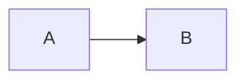

---
format:
  gfm: default
  md: default
  markdown: default
_quarto:
  tests:
    gfm:
      ensureFileRegexMatches:
        - ['``` mermaid', '``` geojson', '``` topojson', '``` stl', '``` plantuml', '``` math', '``` quarto-test-language', '``` text', '``` python', '``` explicit-language']
        - ['language-language-']
    md:
      ensureFileRegexMatches:
        - ['``` mermaid', '``` geojson', '``` topojson', '``` stl', '``` plantuml', '``` math', '``` quarto-test-language', '``` text', '``` python', '``` explicit-language']
        - ['language-language-']
    markdown:
      ensureFileRegexMatches:
        - ['\.quarto-test-language', '\.extra-class']
        - ['language-quarto-test-language']
---



```geojson
{"type":"Point","coordinates":[0,0]}
```

```topojson
{"type":"Topology","objects":{}}
```

```stl
solid example
endsolid example
```

```plantuml
Alice -> Bob: hello
```

```math
x^2
```

```{.quarto-test-language .extra-class}
arbitrary language
```

```text
plain output
```

```python
print("hello")
```

```{.sourceCode .language-explicit-language}
explicit language
```

> ```quarto-test-language
> quoted code
> ```

- Nested code:

  ````quarto-test-language
  ```
  nested fence
  ```
  ````
